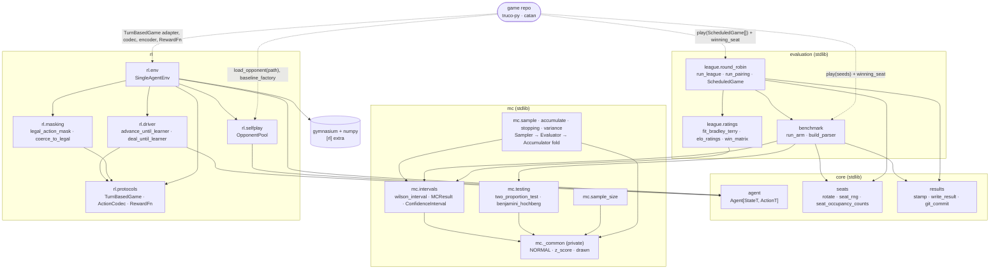

# gamekit

Game-agnostic agents, Monte Carlo statistics, and a benchmark harness for
game-simulation/ML projects.

Extracted from [catan](https://github.com/guidodinello/catan)'s
`agents/base.py`, `experiments/mcstats.py`, and the game-agnostic parts of
`experiments/benchmark.py`, with `truco-py` as the second reference
implementation and mmo-utils' `DESIGN.md` folded in as requirements for the
`mc` module. See `~/projects/docs/shared-ml-package.md` for the full design
history.

## Modules

- `gamekit.agent` — the `Agent[StateT, ActionT]` protocol.
- `gamekit.mc` — confidence intervals (including `wilson_interval`),
  sample-size formulas, two-proportion testing with Benjamini–Hochberg
  multiple-comparison correction, and streaming accumulators (stdlib-only),
  plus one unified Monte Carlo sampling model: `monte_carlo`/`monte_carlo_reduce` (a
  `Sampler -> Evaluator -> Accumulator` fold, admitting both scalar and
  vectorized samplers with no numpy dependency), variance reduction
  (`antithetic`, `control_variate`), and adaptive stopping
  (`monte_carlo_until`, run until a target confidence-interval half-width).
  See [Monte Carlo statistics](#monte-carlo-statistics-gamekitmc) below for what
  each part is for.
- `gamekit.seats` — seat-keyed RNG streams (`seat_rng`, plus the deprecated
  pre-0.2.0 `seat_rng_legacy` for replaying old results), lineup rotation,
  and seat-occupancy counting.
- `gamekit.results` — git-commit-stamped JSON result files.
- `gamekit.benchmark` — a field-free benchmark-arm runner: mandatory seat
  rotation, win-rate summaries by role and by seat, a two-proportion
  comparison, and a CLI skeleton. Never names a game's own record type.
- `gamekit.league` — a seat-rotated round-robin over named agents, resumable
  per pairing, with an anchored Bradley-Terry/Elo fit (stdlib-only), bootstrap
  CIs, the pairwise win matrix, and a cycle report. See research note 022.
- `gamekit.rl` (`[rl]` extra) — the reusable structure of a single-agent RL
  training loop, extracted from `truco-py`'s `training/env.py`:
  `gamekit.rl.protocols` (`TurnBasedGame`, `ActionCodec`, `RewardFn` —
  stdlib), `gamekit.rl.driver` (`advance_until_learner`, auto-stepping every
  non-learner seat until the learner must act, plus the shared reset helpers
  `place_fixed_agents` and `deal_until_learner` — stdlib),
  `gamekit.rl.selfplay` (`OpponentPool`, checkpoint resampling with a
  baseline-mix fallback, run-scoped via `run_id` — stdlib),
  `gamekit.rl.masking` (legal-action mask building and coercing an illegal
  index to a legal one — stdlib), and
  `gamekit.rl.env` (`SingleAgentEnv`, a `gym.Env`
  subclass — needs `gymnasium`/`numpy`, the only submodule that does).
  `gamekit.rl` never imports a training framework (no torch, no
  stable-baselines3/sb3-contrib) — checkpoint loading is injected by the
  caller as a plain callable.

  **What a game whose env step is not one engine action supplies, not
  builds**: `SingleAgentEnv` serves the case where each env step is exactly
  one engine action (one index in, one mask out, `ActionCodec` mapping each
  index to one action). catan spells a multi-parameter action as a short
  sequence of atoms over consecutive env steps; those sub-steps apply nothing
  to the engine, return reward 0 and use no step budget, which breaks the
  one-index-one-action contract. Such a game writes its own `gym.Env` around
  `protocols`/`driver`/`selfplay`, reusing `place_fixed_agents` and
  `deal_until_learner` so the reset contract (seat mapping, RNG draw order,
  the bounded re-deal loop) stays shared — the module split exists
  specifically so that reuse doesn't require a flat action space.
  Either way, a game supplies: a thin `TurnBasedGame` adapter over its own
  engine (no engine change); its own `observation_space`/`action_space`
  objects; an encoder; a reward callable; and, for self-play, a
  checkpoint-loading callable.

## Monte Carlo statistics (`gamekit.mc`)

Everything below is public API, importable from `gamekit.mc` and stdlib-only.
gamekit is a library: parts are documented here by purpose, not by who calls
them today.

**Intervals and tests.** `wilson_interval(k, n)` for any proportion;
`two_proportion_test(k1, n1, k2, n2)` for comparing two arms, with
`benjamini_hochberg` to control the false-discovery rate across many such
comparisons. `MCResult.confidence_interval()` gives a normal CI for a mean.

**Sample size.** Plan `n` before running. `two_proportion_sample_size` is the
per-arm `n` to detect a difference `delta` between proportions near `p`;
`sample_size_clt` and `sample_size_hoeffding` do the same for a [0, 1]-bounded
mean (Hoeffding is distribution-free and more conservative).

```python
from gamekit.mc import two_proportion_sample_size, sample_size_clt

two_proportion_sample_size(0.207, 0.025)  # 4123 per arm, 80% power, alpha 0.05
sample_size_clt(0.01, 0.05)  # 9604
```

**The fold: `monte_carlo`, `monte_carlo_reduce`, `Accumulator`.** One model,
`Sampler -> Evaluator -> Accumulator`. A `Sampler` takes a count and returns
that many values and never owns randomness, so your seed schedule (and common
random numbers across arms) stays yours. `monte_carlo` estimates a mean;
`monte_carlo_reduce` folds through any `Accumulator[V, S, R]`, for estimands
that are not a mean. A numpy-returning sampler works with no numpy import here.

```python
import random
from gamekit.mc import monte_carlo, monte_carlo_reduce, scalar_sampler

rng = random.Random(0)
sampler = scalar_sampler(rng.random)

result = monte_carlo(10_000, sampler, lambda u: u * u)  # E[U^2] = 1/3
result.mean, result.confidence_interval()


class MinMax:  # satisfies Accumulator[float, tuple[float, float], tuple[float, float]]
    init = (float("inf"), float("-inf"))

    def update(self, state, value):
        return (min(state[0], value), max(state[1], value))

    def finalize(self, state):
        return state


monte_carlo_reduce(1_000, sampler, lambda u: u, MinMax())
```

`MeanAccumulator` is the hand-fed counterpart: call `update(sample)` yourself
and read `result()`.

**Adaptive stopping: `monte_carlo_until`.** Use it when the right `n` is not
known upfront, e.g. an expensive evaluation where you want to stop as soon as
the CI is tight enough. It draws in batches and stops at a target half-width or
at a required `max_n`; `target_met` says which.

```python
from gamekit.mc import monte_carlo_until

out = monte_carlo_until(
    sampler, lambda u: u * u, target_half_width=0.005, max_n=100_000
)
out.target_met, out.result.n
```

**Variance reduction.** Both are `Sampler`/`Evaluator` wrappers that compose with
the fold. `antithetic` + `paired_mean` pair each draw with a reflection of it
(helps when the two evaluations are negatively correlated). `control_variate`
subtracts a correlated quantity with a known mean, and `control_beta` estimates
the coefficient from a separate pilot sample.

```python
from gamekit.mc import antithetic, control_beta, control_variate, paired_mean

# E[U] = 0.5; U and 1 - U are perfectly negatively correlated.
monte_carlo(5_000, antithetic(sampler, lambda u: 1.0 - u), paired_mean(lambda u: u))

pilot = [(u * u, u) for u in (rng.random() for _ in range(1_000))]
beta = control_beta(pilot)  # estimate f = u^2 against control c = u (E[c] = 0.5)
monte_carlo(10_000, sampler, control_variate(lambda u: u * u, lambda u: u, 0.5, beta))
```

## Architecture

Solid arrows come from the `import` statements in `src/gamekit`: A → B means A
uses symbols defined in B. (`benchmark` and `league.ratings` import them through
the `gamekit.mc` package.) Dotted arrows show what a game supplies. Every module
except `rl.env` is stdlib-only. `benchmark` and `league` never import `Agent`:
they work with agent *names* and a game-supplied `play` callable.



The `mc.sample · accumulate · stopping · variance` node is collapsed for
readability. Inside it, `sample` imports `accumulate`; `stopping` and `variance`
import `sample`; `stopping`, `sample` and `accumulate` each import
`mc.intervals` directly (for `MCResult`); and `sample` and `stopping` import
`mc._common`. `mc._common` is a private leaf holding the helpers several mc
modules share (the normal distribution, `z_score`, `drawn`); it is not exported.

The package-level edges are enforced in CI by [`tach.toml`](tach.toml): an
import that is not drawn here fails the `Module Boundaries (Python)` job.

A detailed version (module index, what a game implements, data flows) is in
[`docs/architecture.html`](docs/architecture.html), the canonical copy. Open it
in a browser from a clone, since GitHub shows HTML as source. A rendered copy is
also at <https://claude.ai/artifact/Gz3HUTZNnrnqZXwZGUwT7E>; it is private
unless shared and may lag the in-repo file.

## Scope

Core is stdlib + nothing else — no runtime dependencies, including
`gamekit.mc`'s sampling model: a vectorized sampler returning a numpy
`ndarray` satisfies `Sampler[T]` structurally (`Callable[[int],
Iterable[T]]`), so numpy is never imported by gamekit itself. `gamekit.rl`'s
`[rl]` extra (gymnasium + numpy) is the only place a
runtime dependency arrives, and only for callers who install that extra.

## Installation

As a git dependency (the same pattern used by
[`guidodinello/logger`](https://github.com/guidodinello/logger)):

```toml
[project]
dependencies = ["gamekit"]

[tool.uv.sources]
gamekit = { git = "https://github.com/guidodinello/gamekit", branch = "main" }
```

For `gamekit.rl.env`, depend on the `[rl]` extra instead:
`dependencies = ["gamekit[rl]"]`.

## Development

```sh
uv sync --dev                 # add `--extra rl` to exercise gamekit.rl.env
uv run ruff format --check .
uv run ruff check .
uv run mypy src tests
uv run pytest
```

## Releasing

Versions follow [SemVer](https://semver.org); `CHANGELOG.md` is curated by hand and is
the source of the release notes.

1. Open a `chore(release): vX.Y.Z` PR: bump `version` in `pyproject.toml`, move
   `[Unreleased]` under a new `## [X.Y.Z] - YYYY-MM-DD` section, and update the compare
   links at the bottom.
2. Squash-merge it.
3. Tag the merge commit with an **annotated** tag and push it:
   `git tag -a vX.Y.Z -m vX.Y.Z <merge-sha> && git push origin vX.Y.Z`.

The `Release` workflow then verifies the tag matches the version and is on `main`,
builds the wheel and sdist, and creates the GitHub Release with that changelog section
as notes. If verification fails nothing is published: fix it, delete the tag
(`git push origin :refs/tags/vX.Y.Z`), and re-tag.

## Research

Hypotheses, technique notes, and paper citations live in
[`docs/research/`](docs/research/README.md); per-game experiment logs live
in the consumer repos.

## Roadmap

Planned work is indexed in the pinned
[Roadmap issue](https://github.com/guidodinello/gamekit/issues/59), which
orders open issues as Now / Next / Later and groups them by theme.
